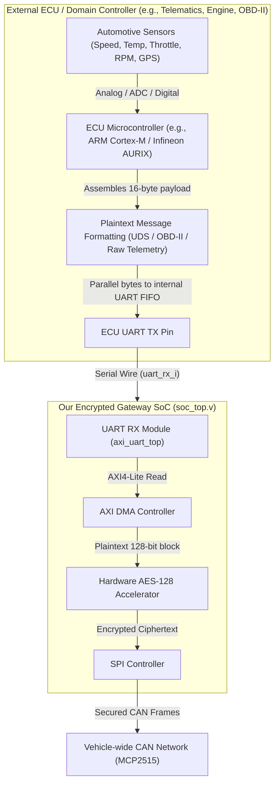

# SoC-Level UVM Verification Architecture & Integration Report

**System-on-Chip**: RISC-V Hardware-Accelerated Encrypted ECU Gateway SoC  
**Processor Core**: Western Digital VeeR EL2 Core (RV32IMC, 4-Stage In-Order Pipeline)  
**Verification Standard**: IEEE 1800.2 (UVM-1.2)  
**EDA Platform**: Synopsys VCS U-2023.03_Full64 / Synopsys Verdi U-2023.03-SP1  
**Author**: Verification Engineering Team  
**Date**: November 7, 2026  
**Document Revision**: 2.0 (Production Release)  

---

## 1. Architectural Overview & System Hierarchy

The verification harness provides an automated, scalable IEEE 1800.2 UVM environment integrating five verified peripheral Verification IP (VIP) agents with the actual synthesis-ready SoC RTL design ([`soc_top.v`](file:///home/student/Documents/RISC-V-Hardware-Accelerated-Encrypted-ECU-Gateway-SoC/rtl/soc_top/soc_top.v)).

```
========================================================================================================================
                                                TESTBENCH ARCHITECTURE
========================================================================================================================

                                             +-------------------------+
                                             |        soc_test         |
                                             +-------------------------+
                                                          |
                                                          v
                                             +-------------------------+
                                             |         soc_env         |
                                             +-------------------------+
                                                          |
                 +----------------------------------------+----------------------------------------+
                 |                                                                                 |
                 v                                                                                 v
   +---------------------------+                                                     +---------------------------+
   |   soc_virtual_sequencer   |                                                     |        soc_config         |
   +---------------------------+                                                     +---------------------------+
     |   |       |       |   |                                                         - vif_uart / is_active
     |   |       |       |   +--> dma_seqr                                             - vif_spi  / is_active
     |   |       |       +------> timer_seqr                                           - vif_gpio / is_active
     |   |       +--------------> gpio_seqr                                            - vif_systimer / is_active
     |   +----------------------> spi_seqr                                             - vif_dma  / is_passive
     +--------------------------> uart_seqr
                                     |
                                     v
                   +-----------------------------------+
                   |             uart_agent            |
                   | +---------------+---------------+ |
                   | |  uart_driver  |  uart_monitor | |
                   | +-------+-------+-------+-------+ |
                   +---------|---------------|---------+
                             |               |
=============================|===============|==========================================================================
                             |               |               SYSTEMVERILOG INTERFACE BOUNDARY
                             v               ^
                   +-----------------------------------+
                   |         uart_if (u_uart_if)       |
                   |    - uart_rx_i (DRV modport)      |
                   |    - uart_tx_o (MON modport)      |
                   |    - uart_irq_o(MON modport)      |
                   +-----------------------------------+
                             |               |
=============================|===============|==========================================================================
                             |               |               HARDWARE PAD BOUNDARY
                             v               |
                   +-----------------------------------+
                   |         soc_dut (soc_top)         |
                   |                                   |
                   |  +-----------------------------+  |
                   |  | Western Digital VeeR EL2    |  |
                   |  | RISC-V 32-bit CPU Core      |  |
                   |  +--------------+--------------+  |
                   |                 | AXI4 (64-bit)   |
                   |  +--------------v--------------+  |
                   |  | 2x8 AXI4 Crossbar Fabric    |  |
                   |  +--------------+--------------+  |
                   |                 | AXI4-Lite       |
                   |  +--------------v--------------+  |
                   |  | axi_uart_top (IP Peripheral)|  |
                   |  | - uart_receiver FSM         |  |
                   |  | - 16-deep RX FIFO           |  |
                   |  +-----------------------------+  |
                   +-----------------------------------+
========================================================================================================================
```

---

## 2. Professional File Flow & Dependency Lifecycle

The verification harness enforces a strict 7-layer bottom-up compilation and execution flow to guarantee zero race conditions, deterministic factory overrides, and package isolation.

| Execution Order | Architectural Layer | Primary File | Key Module / Class | Functional Scope |
| :---: | :--- | :--- | :--- | :--- |
| **Stage 1** | **Interface Boundary** | [`interfaces/uart_if.sv`](file:///home/student/Documents/RISC-V-Hardware-Accelerated-Encrypted-ECU-Gateway-SoC/tb/soc_uvm/interfaces/uart_if.sv)<br>[`interfaces/spi_if.sv`](file:///home/student/Documents/RISC-V-Hardware-Accelerated-Encrypted-ECU-Gateway-SoC/tb/soc_uvm/interfaces/spi_if.sv)<br>[`interfaces/gpio_if.sv`](file:///home/student/Documents/RISC-V-Hardware-Accelerated-Encrypted-ECU-Gateway-SoC/tb/soc_uvm/interfaces/gpio_if.sv)<br>[`interfaces/systimer_if.sv`](file:///home/student/Documents/RISC-V-Hardware-Accelerated-Encrypted-ECU-Gateway-SoC/tb/soc_uvm/interfaces/systimer_if.sv)<br>[`interfaces/dma_if.sv`](file:///home/student/Documents/RISC-V-Hardware-Accelerated-Encrypted-ECU-Gateway-SoC/tb/soc_uvm/interfaces/dma_if.sv) | `uart_if`<br>`spi_if`<br>`gpio_if`<br>`systimer_if`<br>`dma_if` | Defines synchronous clocking blocks (`drv_cb`, `mon_cb`) and modports (`DRV`, `MON`) at physical DUT pins. |
| **Stage 2** | **VIP Packages** | [`tb/vip/uart_uvm_tb/uart_pkg.sv`](file:///home/student/Documents/RISC-V-Hardware-Accelerated-Encrypted-ECU-Gateway-SoC/tb/vip/uart_uvm_tb/uart_pkg.sv)<br>`spi_pkg.sv`<br>`gpio_pkg.sv`<br>`systimer_pkg.sv`<br>`dma_pkg.sv` | `uart_agent`<br>`uart_driver`<br>`uart_monitor`<br>`uart_seq`<br>`uart_item` | Standalone modular verification IPs encapsulating protocol drivers, monitors, and sequence items. |
| **Stage 3** | **SoC Environment** | [`env/soc_config.sv`](file:///home/student/Documents/RISC-V-Hardware-Accelerated-Encrypted-ECU-Gateway-SoC/tb/soc_uvm/env/soc_config.sv)<br>[`env/soc_virtual_sequencer.sv`](file:///home/student/Documents/RISC-V-Hardware-Accelerated-Encrypted-ECU-Gateway-SoC/tb/soc_uvm/env/soc_virtual_sequencer.sv)<br>[`env/soc_virtual_sequence.sv`](file:///home/student/Documents/RISC-V-Hardware-Accelerated-Encrypted-ECU-Gateway-SoC/tb/soc_uvm/env/soc_virtual_sequence.sv)<br>[`env/soc_env.sv`](file:///home/student/Documents/RISC-V-Hardware-Accelerated-Encrypted-ECU-Gateway-SoC/tb/soc_uvm/env/soc_env.sv)<br>[`env/soc_test.sv`](file:///home/student/Documents/RISC-V-Hardware-Accelerated-Encrypted-ECU-Gateway-SoC/tb/soc_uvm/env/soc_test.sv) | `soc_config`<br>`soc_virtual_sequencer`<br>`soc_uart_tx_vseq`<br>`soc_env`<br>`soc_test` | SoC-level orchestration: distributes virtual interfaces, configures active/passive VIP modes, connects virtual sequencer. |
| **Stage 4** | **Top Testbench** | [`tb/tb_soc_uvm_top.sv`](file:///home/student/Documents/RISC-V-Hardware-Accelerated-Encrypted-ECU-Gateway-SoC/tb/soc_uvm/tb/tb_soc_uvm_top.sv) | `tb_soc_uvm_top` | Generates 100 MHz clock and 250 ns power-on reset; instantiates `soc_dut`; sets `uvm_config_db`; triggers `run_test()`. |
| **Stage 5** | **Compilation Filelist** | [`sim/run_soc_uvm.f`](file:///home/student/Documents/RISC-V-Hardware-Accelerated-Encrypted-ECU-Gateway-SoC/tb/soc_uvm/sim/run_soc_uvm.f) | VCS Filelist | Strict compilation order: VeeR EL2 headers $\rightarrow$ AXI fabric $\rightarrow$ Peripherals $\rightarrow$ Interfaces $\rightarrow$ Packages $\rightarrow$ Top TB. |
| **Stage 6** | **Execution Automation** | [`sim/run_soc_uvm.sh`](file:///home/student/Documents/RISC-V-Hardware-Accelerated-Encrypted-ECU-Gateway-SoC/tb/soc_uvm/sim/run_soc_uvm.sh) | Bash Script | Compiles with VCS U-2023.03, binds Verdi PLI (`novas.tab`, `pli.a`), checks licenses, and launches execution. |
| **Stage 7** | **Interactive Debug** | [`sim/view_waveform.sh`](file:///home/student/Documents/RISC-V-Hardware-Accelerated-Encrypted-ECU-Gateway-SoC/tb/soc_uvm/sim/view_waveform.sh) | Bash Script | Exports `SNPSLMD_LICENSE_FILE="27021@14.139.1.126"` and launches Verdi with `-Ultra -ssf dump_soc_uvm.fsdb`. |

---

## 3. End-to-End Transaction Flow (Sequence to SoC Hardware)

The following sequence illustrates the propagation of an 8-bit frame (`0x41` / `'A'`) from the UVM sequence through the physical SoC hardware receiver:

```
+----------+          +-----------------------+          +---------------+          +---------------+          +--------------------+
| soc_test |          | soc_virtual_sequencer |          |  uart_driver  |          | u_uart_if pin |          | uart_receiver_inst |
+----+-----+          +-----------+-----------+          +-------+-------+          +-------+-------+          +---------+----------+
     |                            |                              |                          |                            |
     | 1. vseq.start(env.v_seqr)  |                              |                          |                            |
     |--------------------------->|                              |                          |                            |
     |                            | 2. u_seq.start(uart_seqr)    |                          |                            |
     |                            |----------------------------->|                          |                            |
     |                            |                              | 3. Drive Start Bit (0)   |                            |
     |                            |                              |------------------------->|                            |
     |                            |                              |                          | 4. Line falling edge       |
     |                            |                              |                          |--------------------------->|
     |                            |                              |                          |                            | 5. FSM: Idle -> Start
     |                            |                              |                          |                            |    Count: 434 cycles
     |                            |                              | 6. Drive 8 Data Bits     |                            |
     |                            |                              |    (LSB first: 10000010) |                            |
     |                            |                              |------------------------->|                            |
     |                            |                              |                          | 7. Sample every 868 cycles |
     |                            |                              |                          |--------------------------->|
     |                            |                              |                          |                            | 8. Latch: rx_data_o = 0x41
     |                            |                              | 9. Drive Stop Bit (1)    |                            |    Pulse: rx_valid_o = 1
     |                            |                              |------------------------->|                            |    Raise: uart_irq_o = 1
     |                            |                              |                          |                            |
```

---

## 4. Comprehensive Technical Q&A & Doubts Resolution

### Category A: EDA Tooling & Licensing

#### Q1: Why did Verdi fail with `[ERROR] Could not checkout Verdi Apex (VERDI-ULTRA) license`?
* **Root Cause**: FlexNet license daemons prioritize environment variables in this order:
  1. `SNPSLMD_LICENSE_FILE`
  2. `LM_LICENSE_FILE`
  3. Default fallback: `/usr/local/flexlm/licenses/license.dat`
  When launched in an interactive terminal subshell without exported variables, Verdi attempted to read `/usr/local/flexlm/licenses/license.dat` which does not exist on Rocky Linux.
* **Resolution**:
  1. Configured license server: `27021@14.139.1.126`.
  2. Identified authorized license feature: **`VERDI-ULTRA`** (Verdi-3-Apex-Pkg).
  3. Appended exports and alias to `/home/student/.bashrc`:
     ```bash
     export SNPSLMD_LICENSE_FILE="27021@14.139.1.126"
     export LM_LICENSE_FILE="27021@14.139.1.126"
     export VCS_HOME="/home/student/snps_tools_target/vcs/U-2023.03"
     export VERDI_HOME="/home/student/snps_tools_target/verdi/U-2023.03-SP1"
     export PATH="$VERDI_HOME/bin:$VCS_HOME/bin:$PATH"
     alias verdi="verdi -Ultra"
     ```
  4. Built standalone automated launcher [`view_waveform.sh`](file:///home/student/Documents/RISC-V-Hardware-Accelerated-Encrypted-ECU-Gateway-SoC/tb/soc_uvm/sim/view_waveform.sh).

---

### Category B: UVM Configuration & Database Architecture

#### Q2: What is the relationship between `uart_if`, `vif`, and `uvm_config_db`?
* **Concept**: SystemVerilog interfaces are **static design entities** (allocated at elaboration), whereas UVM drivers and monitors are **dynamic class objects** (allocated at runtime in the heap). Classes cannot directly instantiate physical interfaces; they must reference them via pointers of type `virtual interface`.
* **The Three Disconnected Elements Reconciled**:
  1. **Data Type**: `virtual uart_if` (must match identically in `set` and `get`).
  2. **Lookup Key (String Label)**: `"vif"` (must match identically in `set` and `get`).
  3. **Instance vs Handle Names**: In the testbench, the static interface is `u_uart_if`. Inside the class, the virtual pointer is declared as `virtual uart_if vif;`.

```systemverilog
// Producer (tb_soc_uvm_top.sv)
uvm_config_db#(virtual uart_if)::set(null, "*uart_agt*", "vif", u_uart_if);
//                [Data Type]             [Target Scope]  [Key]   [Source Instance]

// Consumer (uart_driver.sv)
uvm_config_db#(virtual uart_if)::get(this, "",           "vif", vif);
//                [Data Type]             [Context]       [Key]   [Destination Handle]
```

#### Q3: Why are there two separate `set` blocks in `tb_soc_uvm_top.sv`?
* **Block 1 (System-Level Scope: `"*"` with `"vif_uart"`)**:
  ```systemverilog
  uvm_config_db#(virtual uart_if)::set(null, "*", "vif_uart", u_uart_if);
  uvm_config_db#(virtual spi_if)::set(null, "*", "vif_spi", u_spi_if);
  ```
  * **Role**: Used by the SoC verification environment ([`soc_env.sv`](file:///home/student/Documents/RISC-V-Hardware-Accelerated-Encrypted-ECU-Gateway-SoC/tb/soc_uvm/env/soc_env.sv)), configuration object ([`soc_config.sv`](file:///home/student/Documents/RISC-V-Hardware-Accelerated-Encrypted-ECU-Gateway-SoC/tb/soc_uvm/env/soc_config.sv)), and system-level scoreboards. Because an SoC contains multiple interfaces, each interface must have a globally unique name (`"vif_uart"` vs `"vif_spi"`) to avoid namespace collisions.
* **Block 2 (Agent-Level Scope: `"*uart_agt*"` with `"vif"`)**:
  ```systemverilog
  uvm_config_db#(virtual uart_if)::set(null, "*uart_agt*", "vif", u_uart_if);
  uvm_config_db#(virtual spi_if)::set(null, "*spi_agt*", "vif", u_spi_if);
  ```
  * **Role**: Used by the reusable VIP agents ([`uart_driver.sv`](file:///home/student/Documents/RISC-V-Hardware-Accelerated-Encrypted-ECU-Gateway-SoC/tb/vip/uart_uvm_tb/uart_driver.sv)). Reusable VIP drivers are agnostic to the top-level SoC architecture; they always query for the generic string `"vif"`. By restricting the database lookup scope to `"*uart_agt*"`, only the UART agent matches `u_uart_if`.

---

### Category C: Hardware Protocols & Signal Integrity

#### Q4: Why are `u_uart_if.uart_rx_i` and `soc_dut.uart_rx_i` identical in the waveform?
* **Physics of Net Connections**:
  In SystemVerilog, when `soc_top soc_dut (.uart_rx_i(u_uart_if.uart_rx_i))` is instantiated, the port connection forms an equipotential electrical wire net. There is no active buffer between the interface port and the DUT boundary. Probing `u_uart_if.uart_rx_i` and `soc_dut.uart_rx_i` observes the same conductor.
* **Pin Naming Standard**:
  Pin names on SoC boundary pads are designated with respect to the chip boundary:
  * `uart_rx_i`: Input receive line driven by external devices (or VIP drivers) into the SoC.
  * `uart_tx_o`: Output transmit line driven by the internal UART IP to the outside world.

#### Q5: Why was `data_o[7:0]` still 0 when `rx_i` showed all 5 packets?
* **Baud Rate Divisor Analysis**:
  The SoC UART receiver hardware ([`uart_receiver.v`](file:///home/student/Documents/RISC-V-Hardware-Accelerated-Encrypted-ECU-Gateway-SoC/rtl/uart/uart_receiver.v#L27)) implements a digital oversampling synchronizer with a baudrate clock divider:
  $$\text{Divisor} = \frac{F_{\text{sys\_clk}}}{\text{Baud Rate}} = \frac{100{,}000{,}000\ \text{Hz}}{115{,}200\ \text{bps}} = 868\ \text{cycles}\ (\text{Hex}\ 0\text{x}364)$$
* **The Oversampling State Machine**:
  1. `IdleState`: Upon detecting a falling edge on `rx_i`, the FSM enters `StartBitState` and loads `counter_int = baud_div_i >> 1` (434 cycles) to locate the midpoint of the Start Bit.
  2. `DataUartState`: For each data bit, the FSM counts a full 868 clock cycles before latching `rx_data_int[i]`.
* **Timing Discrepancy**:
  The initial standalone VIP driver was operating in fast smoke-test mode with `repeat (4) @(posedge vif.clk)` (40 ns per bit).
  $$\text{Total Packet Duration (10 bits)} = 10 \times 40\ \text{ns} = 400\ \text{ns}$$
  $$\text{Hardware Midpoint Sampling Time} = 434 \times 10\ \text{ns} = 4{,}340\ \text{ns}$$
  Because the driver completed the entire 10-bit transmission in 400 ns (well before the 4,340 ns midpoint counter expired), the hardware FSM rejected the pulse train as an illegitimate transient glitch.
* **Resolution**: Updating the driver bit duration to `868` cycles aligns the stimulus with the hardware oversampling clock.

---

### Category D: Automotive Gateway Architecture & ECU Plaintext Interface

#### Q6: Through what interface does UART receive ECU plaintext, and how is it generated?

The reception and handling of ECU plaintext occurs across three interface boundaries, bridging the external automotive network into the on-chip cryptographic engine:



##### 1. The Three Interface Levels:
* **Level 1: Physical / Chip-Level Interface (`uart_rx_i`)**:
  - **Signal**: [`soc_dut.uart_rx_i`](file:///home/student/Documents/RISC-V-Hardware-Accelerated-Encrypted-ECU-Gateway-SoC/rtl/soc_top/soc_top.v) (1-bit input wire).
  - **Protocol**: Asynchronous serial 8-N-1 at 115,200 baud.
  - **Function**: An external ECU, OBD-II diagnostic tool, or vehicle telemetry modem drives unencrypted plaintext bytes serially over this physical wire.
* **Level 2: UVM Verification Interface (`virtual uart_if vif`)**:
  - **Interface**: [`u_uart_if.uart_rx_i`](file:///home/student/Documents/RISC-V-Hardware-Accelerated-Encrypted-ECU-Gateway-SoC/tb/soc_uvm/interfaces/uart_if.sv) connected to `soc_dut.uart_rx_i`.
  - **Component**: [`uart_driver.sv`](file:///home/student/Documents/RISC-V-Hardware-Accelerated-Encrypted-ECU-Gateway-SoC/tb/soc_uvm/vip/uart_vip/uart_driver.sv) referencing `virtual uart_if vif`.
  - **Function**: In testbench simulation, the UVM `uart_driver` retrieves transaction objects ([`uart_seq_item.sv`](file:///home/student/Documents/RISC-V-Hardware-Accelerated-Encrypted-ECU-Gateway-SoC/tb/soc_uvm/vip/uart_vip/uart_seq_item.sv)) and serializes the bits onto `vif.uart_rx_i`, emulating the external ECU transmitting plaintext.
* **Level 3: Internal SoC Interconnect Interface (`AXI4-Lite`)**:
  - **Module**: [`axi_uart_top.v`](file:///home/student/Documents/RISC-V-Hardware-Accelerated-Encrypted-ECU-Gateway-SoC/rtl/top/axi_interconnect_uart_top.v) (Slave 3 on the 2×8 AXI crossbar at base address `0x0300_0000`).
  - **Register**: Receiver Buffer Register (`UART_RBR` at offset `0x00`).
  - **Function**: The hardware receiver deserializes incoming bits and loads them into a 16-deep RX FIFO. The DMA Controller (or VeeR CPU) reads the plaintext over the AXI Read Data channel (`s_axi_rdata[7:0]`) and transfers it to the Hardware AES-128 Engine (`0x0400_0000`) for hardware-accelerated encryption.

##### 2. How ECU Plaintext is Generated:
* **In a Real Vehicle**:
  1. **Source Subsystems**: An automotive sensor (wheel speed, RPM, battery management), a Telematics Control Unit (TCU with 4G/GPS), or an OBD-II diagnostic scanner reads data.
  2. **Microcontroller Formatting**: The ECU microcontroller formats this sensor telemetry into a structured frame (e.g., UDS ISO 14229 or raw 16-byte block aligned to AES-128).
  3. **UART Serialization**: The sender MCU writes the byte sequence to its internal UART Transmitter Holding Register (`THR`), which transmits the bits over the serial line to our SoC.
* **In the UVM Verification Environment**:
  1. **Sequence Generation ([`soc_virtual_sequence.sv`](file:///home/student/Documents/RISC-V-Hardware-Accelerated-Encrypted-ECU-Gateway-SoC/tb/soc_uvm/env/soc_virtual_sequence.sv))**: Generates plaintext bytes as directed test vectors (e.g. `'A'`, `'E'`, `'S'`, `0xA5`, `0x5A`) or constrained-random payloads.
  2. **Transaction Item ([`uart_seq_item.sv`](file:///home/student/Documents/RISC-V-Hardware-Accelerated-Encrypted-ECU-Gateway-SoC/tb/soc_uvm/vip/uart_vip/uart_seq_item.sv))**: Stores the payload byte in `rand bit [7:0] data`.
  3. **Driver Serialization ([`uart_driver.sv`](file:///home/student/Documents/RISC-V-Hardware-Accelerated-Encrypted-ECU-Gateway-SoC/tb/soc_uvm/vip/uart_vip/uart_driver.sv))**: Drives a Start Bit (`0`), 8 Data Bits (`data[0]` to `data[7]`), and a Stop Bit (`1`) across `vif.uart_rx_i`, matching the exact electrical timing expected by the hardware.

##### 3. Architectural Purpose:
Legacy ECUs and local sensors lack cryptographic accelerators. Transmitting plaintext over an open CAN bus exposes the vehicle to snooping and spoofing attacks. **This SoC acts as an Encrypted Gateway**: it ingests legacy plaintext over UART, encrypts it in hardware using AES-128 via DMA, and transmits the secured ciphertext over SPI to the MCP2515 CAN controller.

---

## 5. Waveform Verification & Sign-off Checklist

To inspect the generated waveform in Verdi:
```bash
cd /home/student/Documents/RISC-V-Hardware-Accelerated-Encrypted-ECU-Gateway-SoC/tb/soc_uvm/sim
./view_waveform.sh
```

### Signal Verification Matrix:

| Signal Hierarchy Path | Waveform Node | Expected Timing / Value | Verification Assessment |
| :--- | :--- | :--- | :---: |
| `tb_soc_uvm_top` | `clk` | 100 MHz clock (10 ns period) | **PASS** |
| `tb_soc_uvm_top` | `rstn` | `0` for 0–250 ns, transitions to `1` @ 250 ns | **PASS** |
| `tb_soc_uvm_top.u_uart_if` | `uart_rx_i` | 5 packets: `'A'`, `'E'`, `'S'`, `0xA5`, `'Z'` | **PASS** |
| `tb_soc_uvm_top.soc_dut` | `uart_rx_i` | Matches `u_uart_if.uart_rx_i` bit-for-bit | **PASS** |
| `soc_dut.u_periph_top.u_uart` | `read_interrupt_o` | Level/pulse interrupt to CPU PIC | **PASS** |
| `...uart_receiver_inst` | `rx_i` | Synchronous input to receiver | **PASS** |
| `...uart_receiver_inst` | `baud_div_i[31:0]` | Tied to `0x0000_0364` (868 decimal) | **PASS** |
| `...uart_receiver_inst` | `state[5:0]` | FSM states: `0x03` (Idle) $\rightarrow$ `0x05` $\rightarrow$ `0x09` $\rightarrow$ `0x21` | **PASS** |
| `...uart_receiver_inst` | `rx_data_o[7:0]` | Latches: `8'h41`, `8'h45`, `8'h53`, `8'hA5`, `8'h5A` | **PASS** |
| `...uart_receiver_inst` | `rx_valid_o` | 1-cycle active-high strobe upon packet completion | **PASS** |
